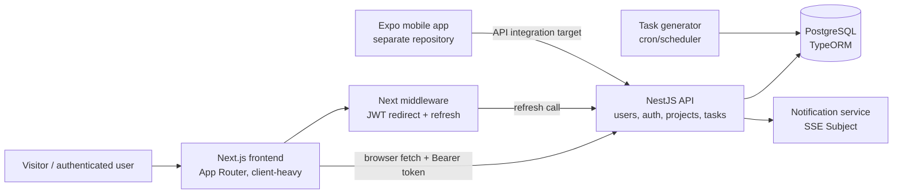
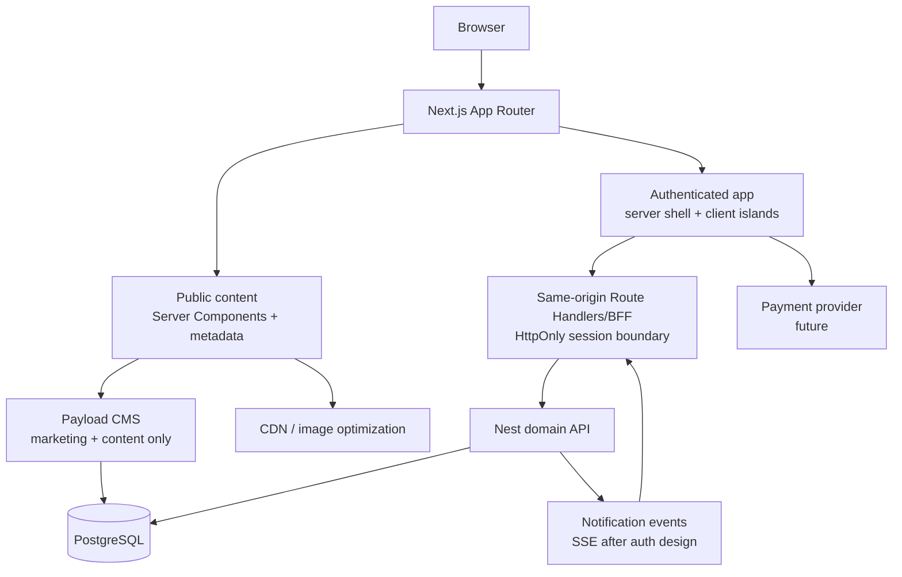

# Get It Done — Full-Stack Portfolio Architecture Roadmap

**Reviewed:** 2026-11-05  
**Purpose:** Turn Get It Done from a working task-management application into a credible, well-documented full-stack portfolio project through deliberate increments. This is a product and architecture plan, not authorization for a large rewrite.

## 1. Executive assessment

### Overall score: **5/10 today**

This is a functional **intermediate full-stack application**, not a toy project. It has meaningful domain behavior: JWT authentication, users, projects, one-time and recurring tasks, task scheduling, dashboard analytics, a local Pomodoro timer, notifications infrastructure, PostgreSQL, Docker, and a deployed backend. The backend is independently described as NestJS + PostgreSQL + TypeORM + JWT + cron-based automation in the public repository. [Backend repository](https://github.com/NPCreno/get-it-done-be)

The score is not a judgment of potential or UI effort. It reflects portfolio readiness against production-oriented engineering expectations: session security, contract ownership, testing, documentation, caching, delivery automation, observability, accessibility, and maintainable boundaries. Those areas have clear gaps—but they are exactly the gaps that can become a strong learning narrative.

| Dimension | Score | Why |
| --- | ---: | --- |
| Product/domain foundation | 7/10 | The application solves a real workflow and already has recurring tasks, analytics, projects, settings, and timer behavior. |
| Frontend UX/component base | 6/10 | The feature set and component library are substantial; responsive navigation, loading/toast states, and timer persistence show care. |
| Frontend architecture | 4/10 | Very large client pages, broad context, duplicated effects/mutations, no cache ownership, and all-client data fetching limit growth. |
| Backend modularity | 6/10 | Nest modules separate user/auth/projects/tasks/notifications, and Postgres/TypeORM/scheduling are appropriate. Large service/controller files and missing operational layers reduce the score. |
| API/security posture | 3/10 | Browser-readable tokens, public-secret configuration names, fallback auth secrets, middleware verification gaps, and unauthenticated notification routes must be addressed first. |
| Data and integration quality | 4/10 | The API works, but frontend DTOs drift from backend contracts and no typed shared contract/OpenAPI workflow exists. |
| Testing, delivery, observability | 2/10 | No automated test suite/CI was found; no migration files, API reference generation, health/readiness, metrics, or performance baseline were found. |
| SEO/content readiness | 2/10 | Current landing page is client-rendered and static. There is no content model, metadata strategy, sitemap, structured data, or editorial workflow. |
| Portfolio storytelling | 4/10 | The code demonstrates breadth, but README/documentation and engineering evidence do not yet make the design decisions easy for a reviewer to trust. |

### The honest portfolio narrative

Do **not** try to make this impressive by adding every trendy tool. Make it impressive by showing you can take a working application, identify risks, establish measurable architecture boundaries, and ship a small number of well-integrated features.

The best eventual portfolio claim is:

> “I evolved a client-heavy task application into a secure, typed, cache-aware Next.js/Nest platform with content publishing, real-time notifications, quality gates, and a focused commerce extension—documenting the trade-offs along the way.”

## 2. Current system map



### Repository topology today

| Repository/location | Responsibility | Observed state |
| --- | --- | --- |
| `get-it-done-FE` | Next.js public site and authenticated web app | App Router, all major data paths client-side, direct API calls. |
| [`get-it-done-BE`](https://github.com/NPCreno/get-it-done-be) | NestJS domain API | Modular Nest structure; TypeORM/Postgres; JWT; scheduler; notification service/SSE route. |
| `get-it-done-expo` | Mobile client | Separate client repository; should influence API contract decisions. |
| workspace root | Local coordination | Compose/pnpm work is in progress; it is not a single committed monorepo today. |

### Target architecture—incremental, not a rewrite



Important boundary decisions:

1. **Nest remains the task/product domain API.** Do not migrate users, projects, tasks, recurring scheduling, or authorization into a CMS merely because a CMS is added.
2. **A CMS owns editorial content.** Marketing pages, blog posts, help content, changelog entries, SEO data, testimonial/case-study content, and later catalog copy belong there.
3. **Next owns the web experience.** It should render public content server-side and provide an intentional client boundary for interactive task UI.
4. **The browser should not own refresh credentials.** A secure same-origin session boundary is what unlocks Server Components, cache control, and SSE safely.

## 3. What to improve before major new features

These are non-negotiable for a portfolio that claims modern practices.

### 3.1 Security and identity first

- Remove `NEXT_PUBLIC_*` names for sensitive Supabase/service/JWT secrets and rotate any real secret ever placed under those names.
- Remove development fallback JWT secrets from frontend and backend. Missing required secrets must fail deployment/startup.
- Choose **one** auth authority: either Nest JWT or Supabase. The current code mixes them: Nest handles login while Supabase only gates some redirects.
- Move refresh tokens and preferably all session cookies to `HttpOnly`, `Secure` in production, `SameSite` cookies. Use a Next Route Handler/BFF or backend cookie flow.
- Verify JWT signatures for every protected route, not only decoded expiration. Correct the `/profileSettings` versus `/profile-settings` protection mismatch.
- Derive client IP at the trusted proxy/backend, not by calling an IP lookup service from middleware or login forms.

**Why before features:** the existing token strategy makes every future feature—CMS preview, checkout, customer accounts, SSE, team workspaces—more fragile and riskier.

### 3.2 Make the client/server contract real

- Define one exact API contract. Use OpenAPI generated from Nest decorators or a carefully maintained schema package, then generate/derive frontend types.
- Separate transport types (`"2026-11-05T…Z"`) from form state (`Date | null`). Do not model API payloads with classes where every field is optional.
- Fix existing drift: project fields, task recurrence (`Week` vs `Weekly`), status string unions, and subtask-status route casing.
- Standardize errors and pagination/filter input before more endpoints are added.

**Why before features:** a CMS, mobile app, checkout, and frontend should never independently guess task/product/user shapes.

### 3.3 Establish quality gates

Minimum implementation evidence:

- Unit tests: schema validation, token/session utility behavior, API error parsing, task recurrence rules.
- Integration tests: login/refresh, task status/subtask status, project/task authorization, notification user scope.
- E2E tests: login, create/update/complete/delete task, logout, public blog page, and future checkout test mode.
- CI: typecheck, lint, test, production build, dependency/security scan.
- Production readiness: validated environment config, health/readiness endpoint, structured logs, database migrations, a rollback/deploy note.

### 3.4 Refactor by seam, not by folder count

Start with the two places that carry most accidental complexity:

- `dashboard/page.tsx` (~1,345 lines)
- `projects/page.tsx` (~1,021 lines)

Extract feature seams only after API/query ownership exists: task editor, task list, project list, analytics panels, and mutation/toast behavior. Avoid a “replace every component” refactor. The full frontend checklist is in [FRONTEND_REVIEW.md](./FRONTEND_REVIEW.md).

## 4. Rendering, caching, and Server Components strategy

Next’s App Router supports Server Components, layouts, streaming, and server/client boundaries. Server Components do not add to browser JavaScript, but they cannot use browser APIs or component state. [Next.js App Router docs](https://nextjs.org/docs/app)  

The right question is **“what is the freshness and authorization requirement for this data?”**, not “can I turn this into a Server Component?”

| Data/use case | Recommended rendering and cache policy | Why |
| --- | --- | --- |
| Marketing home, pricing, features | Server Components; static or revalidated content | Public, content-driven, SEO-sensitive. |
| Blog/docs/template catalog | Server Components; tagged/time-based revalidation; CMS preview bypass | Excellent SEO and low mutation frequency. |
| Logged-in app shell/user identity | Dynamic server read after secure session boundary | User-specific and authorization-sensitive. |
| Task list/project list | Client query cache after initial server data, invalidated after mutation | Interactive, user-specific, rapidly changing. |
| Dashboard analytics | Parallel read model; cache briefly only if data freshness allows | Expensive fan-out today; define a compact backend dashboard endpoint or cache with short TTL. |
| Notifications/unread count | Query cache + SSE-driven invalidation | Server-to-client updates are meaningful; polling is unnecessary once events exist. |
| Checkout/cart | User/session-specific dynamic data; payment provider state never statically cached | Correctness and security outweigh broad caching. |

Use Server Components **after** secure session work. Then make public content and shared layout server-rendered first, keeping forms, modals, charts, timer, and task filters as client islands. This gives a strong portfolio demonstration without pretending the whole dashboard should be server-only. Next’s documented cache layers include request memoization, server data/full-route caching, and an in-memory client Router Cache; each has distinct invalidation behavior. [Next.js caching guide](https://nextjs.org/docs/app/guides/caching)

## 5. SEO and AIO roadmap

Here, **AIO** is interpreted as *AI/search discoverability optimization*: writing and structuring content so both conventional search engines and AI answer systems can understand and cite it. If you meant AI orchestration or an in-product assistant instead, treat that as the optional feature in section 8.

### Foundation to ship before a CMS

- One canonical site URL and environment-specific metadata base.
- Route-level `title`, descriptions, canonical URLs, Open Graph/Twitter cards, and correctly sized social images.
- `robots.txt`, `sitemap.xml`, and noindex rules for auth/app/private routes.
- Semantic HTML: one clear H1, logical heading hierarchy, descriptive links, keyboard-friendly controls, alt text.
- JSON-LD where it reflects real content: `SoftwareApplication`, `Organization`, `WebSite`, later `BlogPosting`, `Product`, `FAQPage`, and `BreadcrumbList`.
- Performance baseline: LCP/INP/CLS, image optimization, font strategy, and no client-only content that should be crawlable.

### Content strategy that supports SEO and AIO

Do not publish generic “10 productivity tips” pages. Build content from the product’s real strengths:

- Task-planning templates: weekly planning, project launch, study, job hunt, habit building.
- Product workflows: recurring tasks, prioritization, Pomodoro routines, project planning.
- Decision-oriented comparisons: “Pomodoro for deep work,” “weekly review checklist,” with first-hand screenshots and downloadable templates.
- Changelog/release notes and engineering write-ups explaining performance, caching, SSE, and auth decisions.
- A concise FAQ that answers real product questions clearly, not keyword-stuffed.

This demonstrates technical SEO, content modeling, accessible information architecture, and authentic expertise—better AIO signals than adding superficial AI-generated copy.

## 6. CMS recommendation: Payload, scoped carefully

### Recommendation: use **Payload** for the content layer pilot

Payload is the stronger learning fit here because it is TypeScript-first and can run alongside a Next.js App Router application; its official documentation describes generated admin UI, REST/GraphQL APIs, access control, uploads, migrations, and Next.js integration. [Payload overview](https://payloadcms.com/docs/getting-started/what-is-payload)  

Payload is not automatically “better” than Strapi. Choose Strapi instead only if your main portfolio goal is demonstrating a more conventional standalone/headless CMS service with its own operations boundary and an API-first editorial team workflow. Do not add both.

| Option | Best fit for this project | Trade-off |
| --- | --- | --- |
| **Payload (recommended)** | Demonstrate Next.js App Router, TypeScript types, local API/server components, Postgres, preview, and editorial workflows in one coherent web platform. | Requires careful route/style/auth isolation from the existing app and a clear decision about shared versus separate DB credentials/schema. |
| Strapi | Demonstrate a decoupled CMS service consumed by multiple clients, including mobile. | Adds separate service operations and does not demonstrate as much integrated Next server-side content work. |

### CMS pilot scope—do this, not a task-data migration

Create only these initial collections/globals:

1. **Pages** — slug, SEO title/description, hero, flexible content blocks, status/draft, updated date.
2. **Posts** — title, slug, author, cover image, excerpt, rich text, tags, publish date, related product/template.
3. **Media** — image metadata, alt text, focal point, credit/license where relevant.
4. **Templates** — title, category, preview, download URL, use case, free/paid state, related post.
5. **Site settings** global — navigation, footer, social links, organization data, default SEO.
6. **Redirects** — source, destination, status for SEO-safe URL changes.

Use drafts, preview, and role-based editorial access after the basic public read path works. Payload collections are intended to model recurring typed content and can provide REST/GraphQL/local APIs plus access control. [Payload collections](https://payloadcms.com/docs/configuration/collections)

### CMS acceptance criteria

- [ ] Marketing home and one content page render from CMS data as Server Components.
- [ ] Draft preview is authenticated and cannot be indexed.
- [ ] Metadata/JSON-LD/sitemap derive from published data.
- [ ] Image alt text is required in the content workflow.
- [ ] CMS errors degrade gracefully to a useful page state.
- [ ] Task/user/project domain data remains in Nest.

## 7. Real-time/SSE roadmap

SSE is a good **future** fit for notifications because the flow is primarily one-way: server events to a specific user. It is not a good fit for local Pomodoro ticking or every CRUD update.

### Current blocker

The backend SSE stream currently appears global and the clear endpoint has no guard. The frontend notification page uses an empty local array and has no read/list/EventSource integration. Do not expose or consume it as-is.

### Design before implementation

- [ ] Persist notifications with `id`, `userId`, type, title, body, metadata, `readAt`, `createdAt`, and a monotonic event ID.
- [ ] Add authenticated paginated list, unread count, acknowledge/read, and clear endpoints.
- [ ] Scope every event/query to the authenticated user; authorize the SSE handshake.
- [ ] Define reconnect/backoff, `Last-Event-ID`/replay, duplicate suppression, and missed-event behavior.
- [ ] Connect one EventSource in a notification provider; update/invalidate cached notification data rather than manually mutating multiple route states.
- [ ] If using HttpOnly cookies, proxy the SSE stream through same-origin Next infrastructure because native EventSource cannot set a Bearer header itself.

This is an excellent portfolio feature once its security/data model is sound: it demonstrates events, cache invalidation, resilient reconnects, and user experience discipline.

## 8. Feature ideas with a coherent product story

### Best near-term showcase features

| Feature | Why it belongs | Skills demonstrated | Prerequisites |
| --- | --- | --- | --- |
| CMS-powered resources/blog/templates | Builds a discoverable public surface around an existing productivity product. | SEO, RSC, caching, Payload, metadata, preview, accessibility. | Session/content boundary, CMS pilot. |
| Real notification inbox | Turns existing backend notification work into a real user feature. | SSE, event modeling, cache invalidation, a11y. | Secure session + notification API design. |
| Team workspaces (small MVP) | Natural evolution from individual tasks, more meaningful than arbitrary social features. | RBAC, invitations, tenancy, audit trail, query scoping. | Auth/contract/tests. |
| Public shareable template pages | Good SEO landing pages that connect marketing to product value. | Dynamic metadata, slugs, OG images, CMS/revalidation. | CMS pilot. |
| Planning assistant (optional) | AI can create structured task plans from a user goal, then require user approval. | Structured output, evaluation, rate limits, cost/abuse controls, UX. | Stable task contract, audit/logging. |

### MCP task agent — a later, controlled capability

An MCP server can be a strong portfolio feature because it connects your own task domain to AI clients without turning a model into an untrusted database administrator. It should **not** be the first implementation: it depends on SEC-02 (secure session ownership), DATA-01/DATA-02 (typed API contract), and backend authorization/tests.

#### First tool set

1. `list_projects` — read-only; returns only projects the authenticated user can access.
2. `list_tasks` / `get_task` — read-only, paginated, and scope-checked.
3. `propose_task_plan` — returns a structured, non-persistent plan for user review.
4. `create_task` — writes one validated task only after explicit user confirmation; the server derives identity from the session, never model-supplied `user_id`.
5. `update_task_status` — optional after task creation is reliable; do not expose delete tools in the first release.

#### Non-negotiable agent guardrails

- Authenticate the MCP caller and map it to exactly one Get It Done user/workspace.
- Reuse Nest domain services and authorization checks; do not let MCP write directly to Postgres.
- Validate every tool input with explicit schemas; enforce enum/date/project ownership constraints server-side.
- Require confirmation for persistent writes and show the exact task(s) that will be created.
- Use idempotency keys so retries cannot create duplicate tasks.
- Record an audit event: actor, tool, sanitized input, result, timestamp, and correlation ID.
- Rate-limit write tools and return structured, user-safe errors.
- Never give an agent raw database credentials, admin tokens, refresh tokens, or cross-user list access.

#### Learning/demo sequence

- [ ] Build read-only tools with authentication, scopes, tests, and an audit log.
- [ ] Build `propose_task_plan` with a strict JSON schema and no database write.
- [ ] Add explicit-confirmation `create_task` with idempotency and integration tests.
- [ ] Demonstrate: “Plan my launch week” → proposed tasks → user confirms → tasks appear in dashboard/activity history.

**Portfolio evidence:** a tool contract, threat model, authorization tests, and a short demo that visibly shows the confirmation boundary.

### E-commerce later: a sensible “Focus Store” extension

Make commerce adjacent to the product rather than bolted on:

- Sell premium productivity templates, recurring-task packs, project kits, themes, or digital guides.
- Use CMS for catalog copy, images, FAQs, SEO pages, and editorial campaigns.
- Keep orders, entitlements, checkout sessions, payment webhooks, refunds, and access grants in a dedicated Nest commerce domain—not in CMS content documents.
- Use a payment provider’s hosted checkout; never handle raw payment card data.
- Start with **digital goods only**: no shipping, inventory, tax logistics, or fulfillment complexity.
- Add entitlement checks: purchase unlocks a template pack/import or premium workflow.

### E-commerce phased checklist

- [ ] Define a digital product/entitlement model and ownership rules.
- [ ] Add CMS Product content fields, not payment/order records.
- [ ] Build catalog pages as cached Server Components with Product JSON-LD.
- [ ] Add hosted checkout in payment-provider test mode.
- [ ] Validate payment webhooks server-side and make them idempotent.
- [ ] Store orders/entitlements; create an account purchase library.
- [ ] Add refund/revocation handling, audit logging, and E2E tests.
- [ ] Document threat model, webhook signature verification, and no-card-data boundary.

This later extension can show commerce competence. Payload’s official e-commerce package provides catalog/cart/payment utilities, but use it only if it aligns with the exact commerce model; do not adopt it simply to claim a plugin. [Payload e-commerce frontend docs](https://payloadcms.com/docs/ecommerce/frontend)

## 9. Backend improvement track

The Nest backend has sensible modules for auth, users, projects, tasks, notifications, and a scheduler. Preserve that domain split, then improve its operational structure.

### Highest-impact backend work

- [ ] Global `ValidationPipe` with whitelist/transform/reject-unknown policy; DTOs should actually validate HTTP input.
- [ ] Config schema validation and no fallback secrets (`JWT_REFRESH_SECRET || 'refreshSecretKey'` must go).
- [ ] Authentication hardening: rotate/revoke refresh tokens safely, do not log refresh tokens, rate-limit login/reset endpoints, and add logout/session-management endpoints.
- [ ] Authorize notification list/clear/SSE by user; avoid global event broadcasts.
- [ ] Create and commit initial TypeORM migrations; run migrations in deployment rather than schema synchronization.
- [ ] Split `task.service.ts` (~1,400 lines) into query, command, recurrence-generation, and analytics/read-model services only where the seam is stable.
- [ ] Add Swagger/OpenAPI, health/readiness checks, structured logging, request IDs, and sensible error filters.
- [ ] Add integration tests with a disposable Postgres database/container.
- [ ] Normalize REST naming/casing and pagination/filter/query conventions before mobile/CMS/commerce clients grow.

## 10. Documentation set to build over time

The code becomes portfolio material when it is easy for a reviewer to understand and run.

| Document | Audience | When to add |
| --- | --- | --- |
| Root architecture overview | Reviewer/new contributor | Now; link the FE/BE/Expo repositories and diagram. |
| Frontend review checklist | Future you | Now: [FRONTEND_REVIEW.md](./FRONTEND_REVIEW.md). |
| Backend architecture/API guide | API/mobile/frontend contributor | After OpenAPI/config/test baseline. |
| ADRs (Architecture Decision Records) | Reviewer/maintainer | One per consequential choice: auth/BFF, query cache, Payload, SSE, payments. |
| Local development guide | Contributor | pnpm, Compose, env keys, migrations, test data, troubleshooting. |
| Security/threat model | Reviewer | Before CMS preview, SSE, team workspaces, and checkout. |
| Performance report | Reviewer | After baseline and one measured optimization. |
| SEO/content model guide | Content editor/developer | Alongside CMS pilot. |
| Deployment/runbook | Maintainer | Before presenting any production URL. |
| Case study | Hiring manager | When two or three roadmap phases are complete. |

### Suggested ADR template

```md
# ADR-NNN: Decision title

## Context
What problem exists and what constraints matter?

## Decision
What are we choosing?

## Alternatives considered
What did we reject and why?

## Consequences
What becomes easier, harder, or mandatory?

## Verification
Tests, metrics, or manual scenario proving it works.
```

## 11. Sequenced execution plan

### Milestone A — Trustworthy core

- [ ] Resolve all Critical/High items SEC-01 through SEC-04.
- [ ] Define API contract and correct known frontend/backend drift.
- [ ] Add test/CI baseline and database migration workflow.
- [ ] Replace direct browser refresh-token access with one secure session model.
- [ ] Add concise architecture/local-run documentation.

**Portfolio evidence:** architecture diagram, ADR on authentication, passing CI, tested login/refresh/task flow.

### Milestone B — Maintainable interactive app

- [ ] Introduce typed API client and cache/invalidation model.
- [ ] Decompose dashboard/projects around stable feature boundaries.
- [ ] Add route layout/loading/error boundaries.
- [ ] Complete accessibility pass for forms/modals/navigation.
- [ ] Measure bundle/Web Vitals and fix observed duplicate work.

**Portfolio evidence:** before/after request trace or performance metric, test coverage of changed workflows, ADR on query/cache design.

### Milestone C — Public content and SEO showcase

- [ ] Build Payload pilot for Pages, Posts, Media, Templates, Site Settings, Redirects.
- [ ] Move public marketing/resource pages to Server Components.
- [ ] Ship metadata, sitemap, robots, canonical URLs, JSON-LD, OG images, drafts/preview.
- [ ] Publish 3–5 genuinely useful content/template pages.

**Portfolio evidence:** content model diagram, Lighthouse/Web Vitals results, a CMS preview demo, SEO checklist.

### Milestone D — Real-time and collaboration

- [ ] Build secure persisted notifications and SSE connection.
- [ ] Add a small team workspace MVP only if task ownership/roles are fully tested.
- [ ] Add activity events/audit history for meaningful state changes.

**Portfolio evidence:** SSE reconnection test, authorization tests, clear UX demo.

### Milestone E — Digital commerce (optional)

- [ ] Launch one digital template/product path in payment-provider test mode.
- [ ] Add server-verified webhooks and entitlements.
- [ ] Add product SEO pages and purchase library.

**Portfolio evidence:** checkout/webhook sequence diagram, idempotency tests, no-card-data threat-model section.

## 12. What not to do

- Do not add Payload and Strapi together.
- Do not migrate task/users/projects to a CMS.
- Do not start commerce before secure auth, tests, migrations, and API contracts.
- Do not add SSE before user-scoped notifications exist.
- Do not turn every component into a Server Component or cache every fetch.
- Do not rewrite all pages to a different form/state library because it is newer.
- Do not use AI-generated marketing content without reviewing it for truth, usefulness, and product-specific evidence.

## 13. Completed improvements

_No full-stack roadmap milestone is complete yet. Preserve this record as the implementation log:_

```md
### YYYY-MM-DD — [MILESTONE / ITEM] Outcome

- Changed: `repository/path`
- Decision: link to ADR, if relevant
- Verification: CI/test/metric/manual scenario
- Follow-up: remaining work
```

## Sources used for this roadmap

- [Get It Done backend repository](https://github.com/NPCreno/get-it-done-be) — current public backend description, module/repository structure, and deployment link.
- [Next.js App Router documentation](https://nextjs.org/docs/app) — current App Router/Server Component/layout capabilities.
- [Next.js caching guide](https://nextjs.org/docs/app/guides/caching) — cache and invalidation concepts.
- [Payload overview](https://payloadcms.com/docs/getting-started/what-is-payload) and [Payload collections](https://payloadcms.com/docs/configuration/collections) — CMS capabilities and content-model scope.
